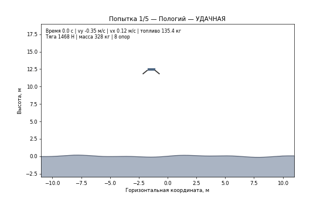
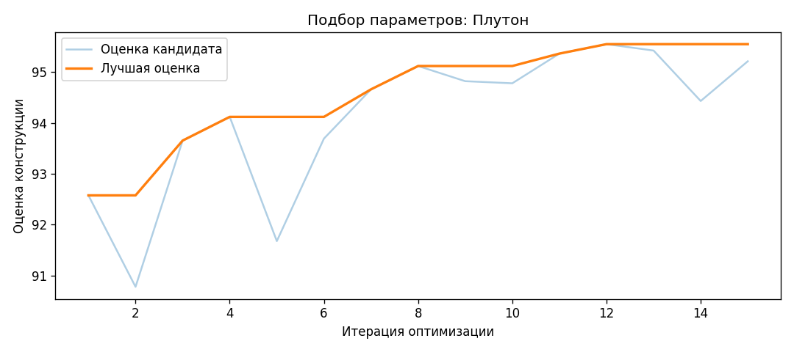
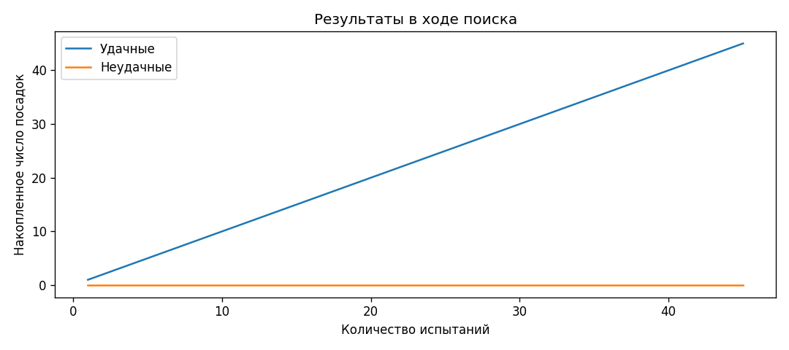
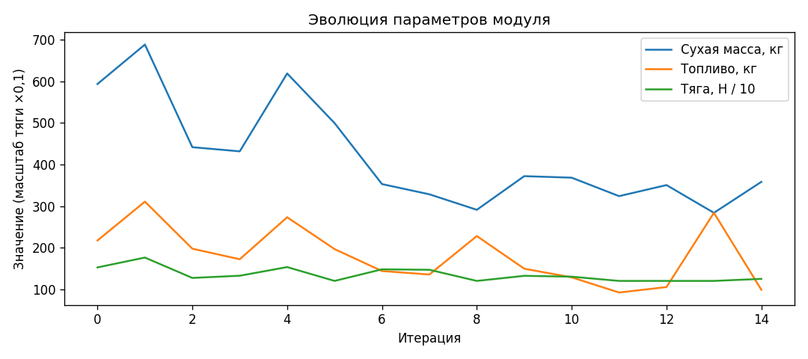
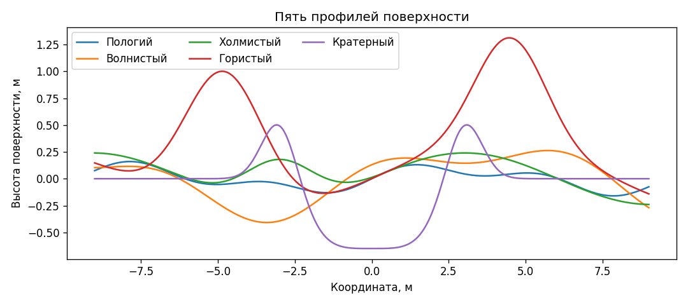

<div align="center">

# Автоматическая оптимизация посадочного модуля

### Компьютерное моделирование мягкой посадки на небесные тела

**Python · 2D-моделирование · стохастическая оптимизация · PD-регулятор · визуализация**

</div>

---

## О проекте

Программа моделирует управляемое снижение космического посадочного модуля и **автоматически подбирает его конструктивные параметры** для мягкой посадки на выбранное небесное тело. Пользователь выбирает только небесное тело; масса аппарата, запас топлива, максимальная тяга и посадочное устройство определяются поисковым алгоритмом.

В ходе работы программа сохраняет **все успешные и неуспешные испытания**, сравнивает кандидатов, проверяет лучшую конструкцию на пяти профилях поверхности, создаёт GIF-анимацию и последовательно показывает четыре графика.

> **Научная оговорка.** Это учебная двумерная модель, а не инженерный симулятор реального космического аппарата. «Идеальная посадка» означает соблюдение заданных критериев в модели. Нахождение такой конструкции не гарантировано.

## Возможности

- Выбор одного из **14 небесных тел** в графическом меню с описанием, значением гравитации и процедурной иллюстрацией.
- Автоматический подбор **сухой массы, массы топлива, максимальной тяги и посадочного устройства**: от 3 до 10 опор или одна посадочная подушка.
- Моделирование движения в вертикальном и горизонтальном направлениях с уменьшением массы по мере расходования топлива.
- Учёт гравитации выбранного тела в **PD-регуляторе тяги**.
- Упрощённая оценка контакта: скорости касания, нагрузки на опоры, тормозного замедления и устойчивости на неровной поверхности.
- Пять типов рельефа, сохранение истории поиска, таблиц CSV, графиков и анимации удачных/неудачных посадок.

## Установка и запуск

**Требования:** Python 3.10 или новее; библиотеки `numpy`, `matplotlib`, `Pillow`. Для графического интерфейса требуется `tkinter` (обычно входит в стандартную установку Python для Windows).

Скачайте проект и выполните в терминале из его папки:

```bash
python -m pip install -r requirements.txt
python main.py
```

В открывшемся окне выберите небесное тело и нажмите **«Начать обучение и поиск»**. Выбор другого тела изменяет гравитацию в расчётах; конструкцию вручную настраивать не требуется.

**Быстрый тест без графических окон и GIF:**

```bash
python main.py --no-gui --body Луна --iterations 12 --trials 2 --no-animation --no-show --output quick_test
```

**Пример расчёта для Плутона с сохранением результатов:**

```bash
python main.py --no-gui --body Плутон --iterations 90 --trials 3 --no-show --output results_pluto
```

При втором запуске GIF сохраняется, но окно его просмотра не открывается. Для запуска с обычным просмотром анимации уберите `--no-show`.

### Параметры командной строки

| Аргумент | Значение | По умолчанию |
|---|---|---|
| `--body` | Небесное тело из списка программы | Луна в режиме `--no-gui`; иначе выбор в окне |
| `--no-gui` | Не показывать меню выбора | Выключен |
| `--iterations N` | Число проверяемых конструкций | `90` |
| `--trials N` | Число испытаний каждой конструкции | `3` |
| `--seed N` | Начальное значение генератора случайных чисел | `42` |
| `--max-time T` | Предельное модельное время одной посадки, с | `90` |
| `--fps N` | Частота кадров GIF | `12` |
| `--output PATH` | Каталог результатов | `results` |
| `--no-animation` | Не создавать GIF | Выключен |
| `--no-show` | Не открывать окна GIF и графиков | Выключен |

> Увеличение `--iterations` и `--trials` обычно повышает объём проверки, но увеличивает время вычислений и не гарантирует успешного результата. При фиксированном `--seed` эксперименты воспроизводимы в пределах используемой программной среды.

## Как устроена математическая модель

### 1. Динамика полёта

В модели учитываются координаты `x`, `y`, скорости `vx`, `vy`, гравитация `g`, текущая масса `m` и тяга двигателей. На каждом временном шаге `Δt = 0,12 с` вычисляются ускорения, новые скорости и координаты. Масса уменьшается при расходовании топлива.

Упрощённая вертикальная динамика:

\[
\frac{dv_y}{dt}=\frac{T_y}{m}-g.
\]

Горизонтальная динамика определяется боковой тягой и малым случайным возмущением. Топливо расходуется пропорционально суммарному запросу тяги; в модели используется постоянная эффективная скорость истечения `2200 м/с`.

### 2. Управление снижением

Гравитационно-компенсированный **PD-регулятор** задаёт требуемую вертикальную скорость в зависимости от высоты, а затем вычисляет необходимую тягу. Отдельный регулятор стремится уменьшить горизонтальное отклонение и скорость. Запрашиваемая тяга ограничивается возможностями выбранной конструкции.

**Важно:** управляющий регулятор фиксирован. Программа оптимизирует **конструкцию модуля**, а не обучает нейронную сеть и не использует Q-learning.

### 3. Посадочное устройство

Варианты: `3–10` опор либо `0` — посадочная подушка. В контактной модели число опор влияет на условную массу конструкции, ширину опорной базы, нагрузку на одну опору и критерий устойчивости. Для подушки предусмотрен больший эффективный ход торможения.

Оценка пикового замедления:

\[
a_{\mathrm{конт}}\approx\frac{v_y^2}{2s},
\]

где `s` — эффективный ход амортизации. Для опор дополнительно рассчитывается приближённая нагрузка на одну опору:

\[
F_{\mathrm{оп}}\approx\frac{m v_y^2}{2sn}.
\]

Это **суррогатная оценка**, а не расчёт упругих деформаций, ударного контакта или опрокидывания в трёхмерной механике.

### 4. Критерии мягкой посадки

Попытка считается успешной, только если одновременно выполняются условия:

| Показатель | Критерий |
|---|---|
| Вертикальная скорость касания | `|vy| ≤ 0,55 м/с` |
| Горизонтальная скорость касания | `|vx| ≤ 0,38 м/с` |
| Отклонение от цели | `|x| ≤ 0,95 м` |
| Устойчивость | Выполнен критерий контактной модели |
| Перегрузка | Не превышен установленный модельный порог |

Превышение времени моделирования, выход за границы расчётной области или нарушение любого условия означает неуспешную попытку.

## Алгоритм оптимизации

1. **Создание кандидата.** Генерируются масса, топливо, тяга и тип посадочного устройства в допустимых диапазонах.
2. **Проверка.** Для кандидата выполняется `--trials` посадок с заданными случайными начальными условиями и профилями рельефа.
3. **Оценка.** Прежде всего учитывается число успешных посадок; дополнительно штрафуются масса, тяга и ошибки приземления.
4. **Поиск улучшений.** Алгоритм сохраняет лучший найденный вариант, создаёт его случайные модификации и периодически исследует новые конструкции.
5. **Контроль.** Несколько лучших кандидатов испытываются с другими случайными начальными условиями на **пяти рельефах**. Выбирается лучший результат контроля.
6. **Представление результатов.** Создаются CSV, четыре графика и GIF с контрольными траекториями и доступными примерами неудач.

Алгоритм представляет собой **стохастическую оптимизацию с сохранением лучших решений и мутациями**. Он не доказывает глобальную оптимальность. Даже результат `5/5` означает успех лишь на пяти конкретных контрольных испытаниях.

## Небесные тела и рельеф

| Небесное тело | Гравитация, м/с² | Небесное тело | Гравитация, м/с² |
|---|---:|---|---:|
| Луна | 1,620 | Меркурий | 3,700 |
| Венера | 8,870 | Земля | 9,810 |
| Марс | 3,710 | Церера | 0,270 |
| Ио | 1,800 | Европа | 1,310 |
| Ганимед | 1,430 | Каллисто | 1,240 |
| Титан | 1,350 | Энцелад | 0,113 |
| Тритон | 0,779 | Плутон | 0,620 |

Профили поверхности: **пологий, волнистый, холмистый, гористый и кратерный**. Это синтетические математические профили, а не топографические карты конкретных небесных тел.

Изображения в меню — **процедурные иллюстрации**, визуально напоминающие соответствующие тела; это не фотографии космических миссий.

## Графики и анимация

После вычислений программа создаёт GIF `landing_animation.gif`. При обычном запуске открывается окно его просмотра. **После закрытия анимации** четыре графика показываются по порядку:

| № | Файл | Что показывает |
|---|---|---|
| 1 | `optimization.png` | Оценка проверяемых конструкций и лучший найденный результат |
| 2 | `success_failure.png` | Накопленное количество удачных и неудачных попыток |
| 3 | `design_evolution.png` | Изменение сухой массы, запаса топлива и тяги в процессе поиска |
| 4 | `terrain.png` | Пять профилей поверхности |

Переключение — кнопками **«Предыдущий» / «Следующий график»** либо клавишами **← / →**. После четвёртого графика кнопка завершает просмотр. Пятый график контрольных испытаний **не создаётся**.

В GIF показываются полные траектории выбранных эпизодов с прореживанием кадров для уменьшения размера файла. Поэтому GIF **не содержит все испытания поиска подряд**; полный учёт попыток находится в CSV и на графике успехов/неудач. Создание GIF может занять несколько минут.

## Пример работы программы

Ниже приведены результаты отдельного воспроизводимого запуска для Плутона: 15 итераций, 3 испытания на конструкцию, seed = 42. Это демонстрационный эксперимент, а не статистическая оценка надёжности.

### Анимация посадок



### 1. Динамика оптимизации



### 2. Удачные и неудачные посадки



### 3. Изменение параметров конструкции



### 4. Профили поверхности



Для отображения иллюстраций на GitHub необходимо загрузить каталог `examples/` вместе с `README.md`, сохранив относительные пути.

## Файлы результатов

После запуска в каталоге `results/` (или указанном через `--output`) появляются:

```text
results/
├── design_search.csv        # параметры и оценка каждого кандидата
├── attempts.csv             # все попытки, исходы и показатели касания
├── best_design.csv          # лучшая конструкция и успехи контроля из пяти
├── optimization.png         # качество поиска
├── success_failure.png      # удачные и неудачные посадки
├── design_evolution.png     # изменение параметров конструкции
├── terrain.png              # профили поверхности
├── landing_animation.gif    # анимация (если не указан --no-animation)
└── animation_final.png      # последний кадр (если создавалась анимация)
```

CSV-файлы можно открыть в Excel, LibreOffice Calc или обработать в Python. Для анализа надёжности используйте `attempts.csv`, а не только финальный результат из `best_design.csv`.

## Как интерпретировать результаты

- Рост линии лучшего результата на `optimization.png` означает, что алгоритм нашёл кандидата с более высокой **модельной оценкой**, но не обязательно глобально оптимальную конструкцию.
- На `success_failure.png` показаны **абсолютные накопленные количества** попыток. Они зависят от числа итераций и испытаний; для сравнения разных запусков следует дополнительно рассчитывать долю успехов.
- `design_evolution.png` отражает параметры **проверяемых кандидатов**, а не обязательно последовательность только лучших конструкций. Для наглядности тяга изображается в масштабе `Н / 10`.
- Результат `5/5` в `best_design.csv` означает успешное прохождение пяти контрольных профилей в одном наборе условий, но **не означает 100% надёжность**.
- Если контроль не пройден, программа сообщает об этом; ограничение числа итераций не превращает неудачу в успех.

## Ограничения и направления развития

- Динамика **двумерная**, без поворота и угловой скорости корпуса.
- **Атмосфера, аэродинамика, ветер и температурные эффекты не учитываются**, в том числе для Земли, Венеры, Марса и Титана.
- Профили рельефа синтетические, параметры контакта и пределы нагрузок условные.
- Опоры и подушка учитываются через приближённые критерии, без полноценной 3D-механики, деформаций и расчёта прочности.
- Используется один фиксированный PD-регулятор; конструкция и закон управления совместно не оптимизируются.
- Ограниченное число случайных испытаний не позволяет оценить редкие аварийные события или доказать заданную вероятность успеха.

Для более строгого исследования потребуются 3D-модель, физическая модель амортизаторов, атмосфера и аэродинамика, ограничения на энергию и ресурс двигателя, независимые серии Монте-Карло и статистические доверительные интервалы.

---

**Назначение:** учебная лабораторная работа по компьютерному моделированию и стохастической оптимизации. Все результаты следует трактовать в рамках принятых допущений.
